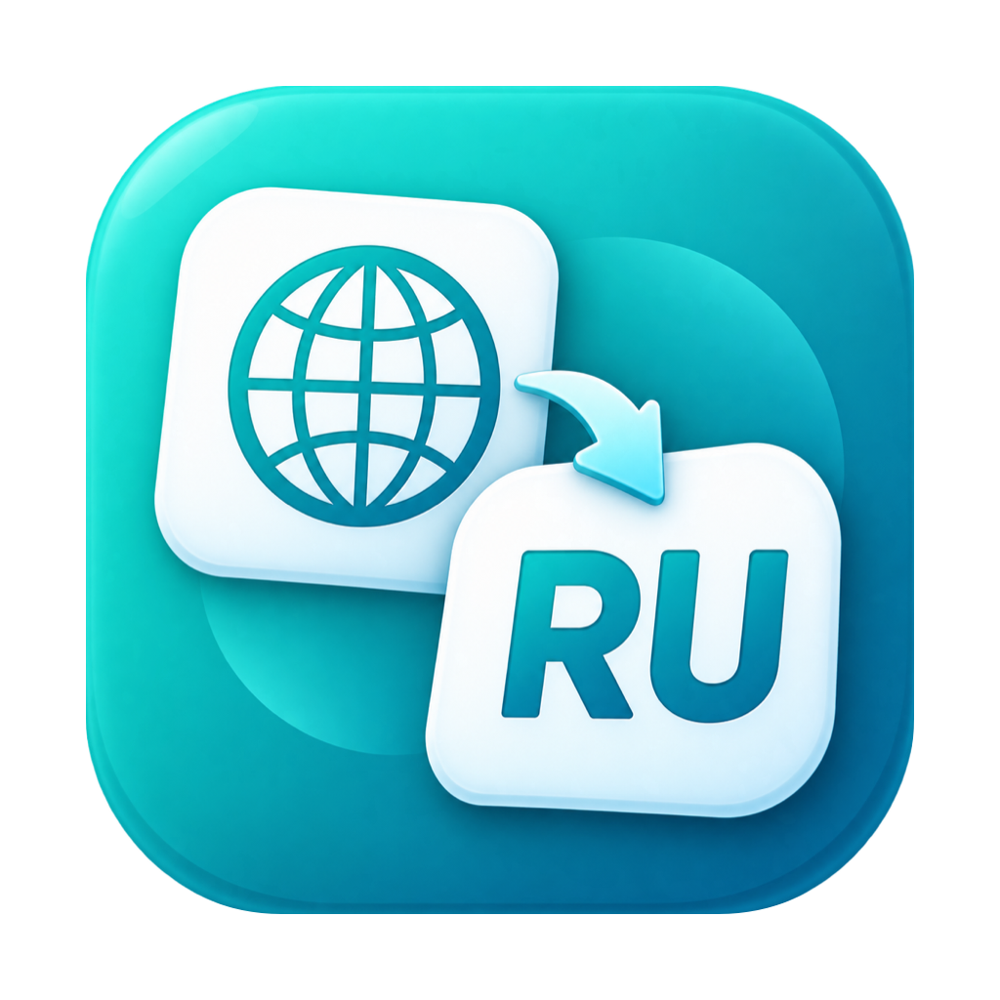
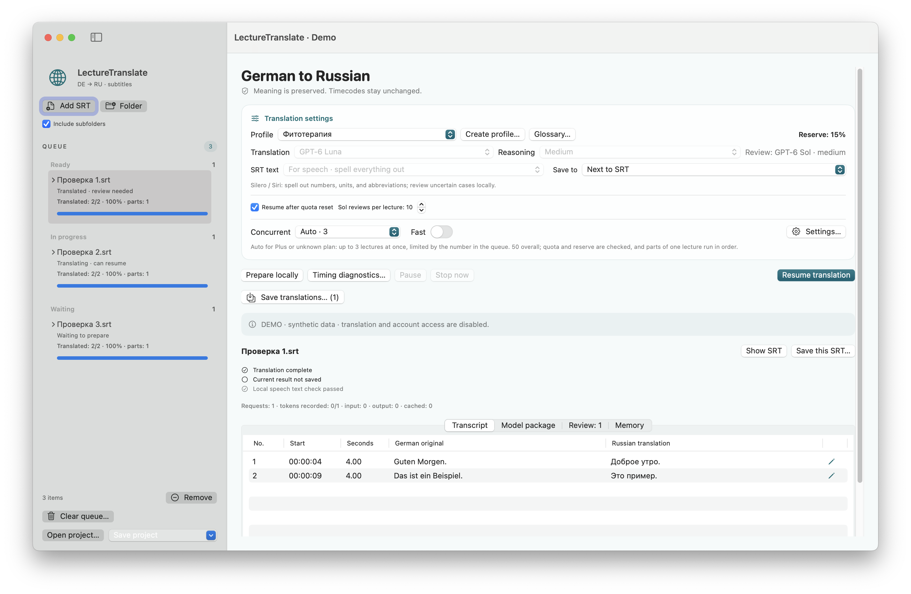

# LectureTranslate

<!-- public-release:start -->
Translate German SRT subtitles into Russian with preserved timecodes, a queue and draft review.

**macOS 15+ · Apple Silicon · Release 3.5.1**

**[Download](https://github.com/popovantondev/LectureTranslate/releases/tag/v3.5.1)** · **[User guide](https://popovantondev.github.io/LectureTranslate/Guide-en.html)** · **[Report a problem](https://github.com/popovantondev/LectureTranslate/issues/new/choose)**

**Requirements and limitations:** Requires a separate connection and sign-in to an external translation service. FFmpeg/ffprobe are optional for specific media features.

**First steps:** Extract the app archive, configure the connection using the guide and add German .srt files. Review translations before use.

**Application files:**

- [`lecture_translate-v3.5.1-app.zip`](https://github.com/popovantondev/LectureTranslate/releases/download/v3.5.1/lecture_translate-v3.5.1-app.zip)

**Checksums:** [`SHA256SUMS`](https://github.com/popovantondev/LectureTranslate/releases/download/v3.5.1/SHA256SUMS)
<!-- public-release:end -->



[Deutsch](README.md) · [Русский](README.ru.md) · **English**

[Download LectureTranslate 3.5.1](https://github.com/popovantondev/LectureTranslate/releases/tag/v3.5.1)

**Current release: 3.5.1 · build 16.** Check the release notes and SHA-256 checksums before downloading. Earlier releases remain available in the GitHub archive.

LectureTranslate is a native macOS app for translating German lecture subtitles (`.srt`) into Russian. Cue IDs and timecodes are preserved. The app offers a resumable queue, local review hints and controlled export as `name.ru.srt`.

**System:** macOS 15 or later, Apple Silicon (arm64). Translation and review require a separate connection and sign-in to the external translation service. Setup: [Build and connection](docs/en/BUILD.md). FFmpeg/ffprobe are optional and only needed for certain local audio and video features.

## Status

The interface is available in German, Russian and English. The local offline suite passed **2473 checks including 14 release validations**, plus isolated GUI checks with synthetic data. This does not demonstrate medical translation quality, nor the speed of 50 real parallel translation requests.

## Documentation

- [User guide in German](docs/de/README.md)
- [User guide in Russian](docs/ru/README.md)
- [User guide in English](docs/en/README.md)
- [Build and local tests in English](docs/en/BUILD.md)
- [Changes in English](docs/en/CHANGELOG.md)
- [Rights and permitted use](RIGHTS.md)
- [Third-party notices in English](docs/en/THIRD-PARTY-NOTICES.md)

## Quick start

1. Add German SRT files or a folder.
2. Choose the translation profile, text output and save location.
3. Start the translation. Finished results are saved in the queue history; the queue can be paused and resumed.

A translation draft is created first; selected risky passages are then reviewed. A saved SRT with open hints is therefore not professionally confirmed. Check names, unclear recognition, quantities and medical statements against the German original and, if needed, the video.

## Screenshot



This is a synthetic demo screenshot. Model access and account access are disabled.

## Data and privacy

The queue, translation logs, usage logs and term collection are stored locally under `~/Library/Application Support/LectureTranslator2/`. A `.lectureproject` file can contain subtitle text, translations, notes and local file paths; media and credentials for the translation service are not packaged. Treat projects and local state as confidential.

Translation and review text is sent to the external service over the signed-in connection. Build, offline tests and demo functions need no sign-in and send no translation requests. Do not upload real lectures, project archives, logs, credentials, personal paths or private screenshots to public issues.

## Build and test locally

Requirements: macOS 15+, Apple Command Line Tools, Bash and Ruby. In the project directory:

```sh
bash Scripts/test-all.sh
bash Scripts/build.sh --preview
```

The local offline tests passed 2473 checks including 14 release validations. Twelve synthetic main GUI windows (DE/RU/EN, light/dark, compact/large) as well as the start screen and menus were checked; not every single dialog was walked through. The published package [3.5.1 · build 16](https://github.com/popovantondev/LectureTranslate/releases/tag/v3.5.1) is available. Preview builds remain separate test packages. More details: [Build and local tests](docs/en/BUILD.md).

## Rights and third parties

No open-source license is granted for the original source code. Public visibility is not permission to copy, modify, redistribute or sell the source code or derivative versions outside the GitHub platform. Downloading and running an unmodified release binary is permitted for personal use. Details: [Rights and permitted use](RIGHTS.md) and [third-party notices](docs/en/THIRD-PARTY-NOTICES.md).

The published ZIP carries no Developer ID signature and no Apple notarization; macOS may warn on first launch. The notices about original code grant no rights to lecture material, external services or optional FFmpeg builds.
