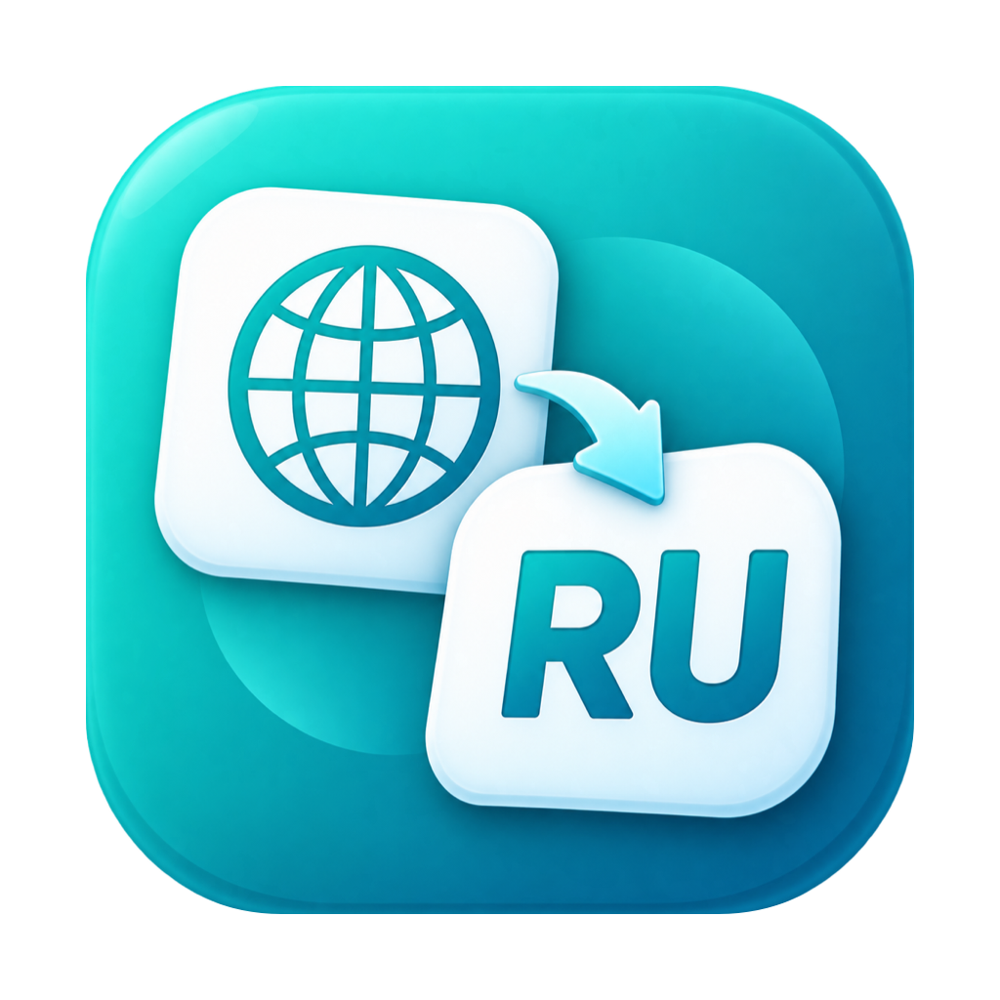
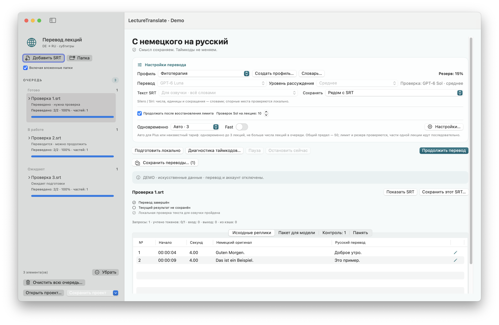

<div align="center">
  
</div>

# LectureTranslate

**Русский** · [Deutsch](README.md) · [English](README.en.md)

<!-- public-release:start -->
Переводит немецкие SRT-субтитры на русский с сохранением таймкодов, очередью и проверкой черновика.

**macOS 15+ · Apple Silicon · Выпуск 3.5.1**

**[Скачать](https://github.com/popovantondev/LectureTranslate/releases/tag/v3.5.1)** · **[Инструкция](https://popovantondev.github.io/LectureTranslate/Guide-ru.html)** · **[Сообщить об ошибке](https://github.com/popovantondev/LectureTranslate/issues/new/choose)**

**Требования и ограничения:** Нужны отдельное подключение и вход во внешний сервис перевода. FFmpeg/ffprobe необязательны для отдельных медиафункций.

**Первые шаги:** Распакуйте архив приложения, настройте подключение по руководству и добавьте немецкие .srt. Проверяйте перевод перед использованием.

**Файлы приложения:**

- [`lecture_translate-v3.5.1-app.zip`](https://github.com/popovantondev/LectureTranslate/releases/download/v3.5.1/lecture_translate-v3.5.1-app.zip)

**Контрольные суммы:** [`SHA256SUMS`](https://github.com/popovantondev/LectureTranslate/releases/download/v3.5.1/SHA256SUMS)
<!-- public-release:end -->

**[Сайт](https://popovantondev.github.io/LectureTranslate/index-ru.html)** · **[Попробовать в браузере](https://popovantondev.github.io/LectureTranslate/index-ru.html#demo)**



Это синтетический демонстрационный снимок. Доступ к модели и аккаунту отключён.

**Текущий выпуск: 3.5.1 · сборка 16.** Перед загрузкой проверьте заметки к выпуску и контрольные суммы SHA-256. Предыдущие выпуски остаются в архиве GitHub.

LectureTranslate — нативное приложение для macOS, которое переводит немецкие субтитры лекций (`.srt`) на русский. Номера реплик и таймкоды сохраняются. В приложении есть очередь с возможностью продолжить, локальные подсказки для проверки и контролируемый экспорт как `name.ru.srt`.

**Система:** macOS 15 или новее, Apple Silicon (arm64). Для перевода и проверки нужны отдельное подключение и вход во внешний сервис перевода. Настройка: [Сборка и подключение](docs/ru/BUILD.md). FFmpeg/ffprobe необязательны и нужны только для некоторых локальных функций с аудио и видео.

## Состояние

Интерфейс доступен на немецком, русском и английском. Локальный офлайн-набор прошёл **2473 проверки, включая 14 проверок релиза**; кроме того, выполнены изолированные проверки интерфейса на синтетических данных. Это не подтверждает качество медицинского перевода и скорость 50 реальных параллельных запросов на перевод.

## Документация

- [Руководство пользователя на немецком](docs/de/README.md)
- [Руководство пользователя на русском](docs/ru/README.md)
- [Руководство пользователя на английском](docs/en/README.md)
- [Сборка и локальные тесты на русском](docs/ru/BUILD.md)
- [Изменения на русском](docs/ru/CHANGELOG.md)
- [Права и допустимое использование](RIGHTS.md)
- [Сведения о сторонних компонентах на русском](docs/ru/THIRD-PARTY-NOTICES.md)

## Быстрый старт

1. Добавьте немецкие SRT-файлы или папку.
2. Выберите профиль перевода, вывод текста и место сохранения.
3. Запустите перевод. Готовые результаты сохраняются в истории очереди; очередь можно приостановить и продолжить.

Сначала создаётся черновик перевода, затем проверяются выбранные рискованные места. Сохранённый SRT с открытыми замечаниями поэтому не считается проверенным по существу. Имена, неясное распознавание, количества и медицинские утверждения сверяйте с немецким оригиналом и при необходимости с видео.

## Данные и конфиденциальность

Очередь, журналы перевода, журналы использования и собрание терминов хранятся локально в `~/Library/Application Support/LectureTranslator2/`. Файл `.lectureproject` может содержать текст субтитров, переводы, заметки и локальные пути к файлам; медиа и учётные данные сервиса перевода в него не упаковываются. Проекты и локальное состояние считайте конфиденциальными.

Тексты для перевода и проверки передаются внешнему сервису по выполненному входу. Сборка, офлайн-тесты и демонстрационные функции не требуют входа и не отправляют запросов на перевод. Не загружайте в публичные issues настоящие лекции, архивы проектов, журналы, учётные данные, личные пути и приватные снимки экрана.

## Локальная сборка и тесты

Требования: macOS 15+, Apple Command Line Tools, Bash и Ruby. В каталоге проекта:

```sh
bash Scripts/test-all.sh
bash Scripts/build.sh --preview
```

Локальные офлайн-тесты прошли 2473 проверки, включая 14 проверок релиза. Проверены двенадцать синтетических главных окон (DE/RU/EN, светлая/тёмная тема, компактный/большой размер), а также стартовый экран и меню; не каждое диалоговое окно проходилось по отдельности. Опубликованный пакет [3.5.1 · сборка 16](https://github.com/popovantondev/LectureTranslate/releases/tag/v3.5.1) доступен. Предварительные сборки остаются отдельными тестовыми пакетами. Подробнее: [Сборка и локальные тесты](docs/ru/BUILD.md).

## Права и сторонние компоненты

Для исходного кода не предоставляется лицензия открытого ПО. Публичная видимость не даёт права копировать, изменять, распространять или продавать исходный код и производные версии вне платформы GitHub. Скачивать и запускать неизменённый бинарный файл выпуска для личного использования разрешено. Подробности: [Права и допустимое использование](RIGHTS.md) и [сведения о сторонних компонентах](docs/ru/THIRD-PARTY-NOTICES.md).

Опубликованный ZIP не имеет подписи Developer ID и нотаризации Apple; при первом открытии macOS может предупредить. Заметки о собственном коде не дают прав на материалы лекций, внешние сервисы и необязательные сборки FFmpeg.
